# 戦場ゲーム

赤チームと青チームに分かれて戦う、**ターン制のチーム対戦ミニゲーム**です。
職業（戦士・武道家・魔法使い・僧侶）を選び、マス目の上で順番に「移動・攻撃・魔法・待機」をくり返して、相手チームを全滅させるか、相手の城にたどり着いたら勝ちです。

> このページは、当時の説明書が残っていなかったため、サーバーとクライアントのソースコードから読み取ってまとめたものです。
> 数字（確率・ダメージ）はすべてコードどおりです。スクリーンショットは、手元で動かしたサーバーで2人で試合をして撮ったものです。

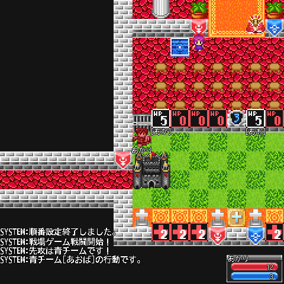

---

## ざっくり言うと

- 1チーム **最大4人**（今のデータでは 4人戦の設定）。赤 vs 青。
- 1人ずつ順番に行動します。**赤チーム全員が動いたら、次は青チーム全員**、のくり返しです。
- HP は **5**。ダメージを 5 受けるとやられます。
- 勝ち方は試合前に選ぶ2種類。
  - **全滅させる**（自動復活なし）
  - **城へ到達**（3ターンで自動復活あり）

---

## 参加のしかた

1. **戦場ゲーム場** に行き、受付の場所（受付のマス）に立ちます。
2. 道具から **「戦場ゲーム参加チケット」** を使います。チケットは使うとなくなります（無効試合になっても戻りません）。
   - 受付の場所以外で使うと「ここは受け付け場所ではないようです。」と出ます。
   - すでに試合が始まっているときは「すでに参加は締め切られています。」と出ます。
3. コマンド（X）を開いて **赤チーム / 青チーム** を選びます。
   - 1チーム4人までです。満員だと「そちらのチームは満員のようです。」と出ます。
4. 選んだチームの開始位置へ移動して、ほかの人を待ちます。

| チケットを使う | チームを選ぶ | 参加受付 |
| --- | --- | --- |
| 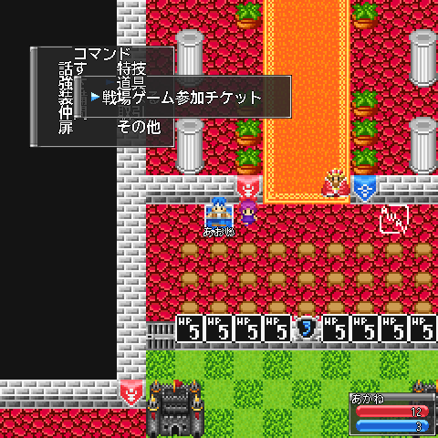 | 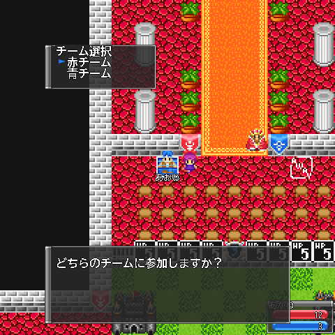 | 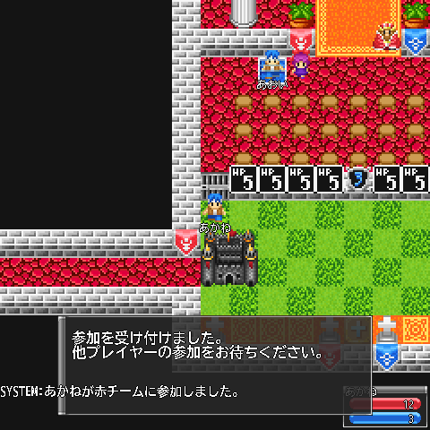 |

待っている間にコマンドを開くと **「戦場ゲームから抜ける」** を選べます。抜けると受付の場所に戻ります。

---

## 試合の流れ

審判のキャラクターが、画面に残り時間などを知らせてくれます（10秒ごと）。

| 段階 | 時間 | やること |
| --- | --- | --- |
| 参加者募集 | 最初の1人が参加してから **60秒** | チームを選んで待つ |
| ルール選択 | **10秒** | 勝利条件を選ぶ |
| 職業選択 | **10秒** | 職業を選ぶ |
| 行動順設定 | **10秒** | チーム内の行動順を決める |
| 試合 | 決着がつくまで | 順番に行動する |

- 募集が終わったとき、**どちらかのチームが0人だと無効試合** になります。

### ルール選択（勝利条件）

参加者の誰でも選べます。**最後に選ばれたもの** が使われます。だれも選ばなければ「全滅させる」です。

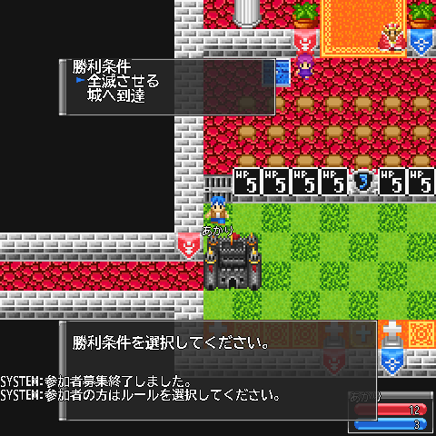

| ルール | 勝ち方 | やられた人 |
| --- | --- | --- |
| 全滅させる | 相手チームを全員やっつける | 自動では復活しない（僧侶の「蘇生」だけ） |
| 城へ到達 | 相手の城に着いて「待機」する | 自分の番が3回来ると自動で復活 |

※ 「城へ到達」ルールでも、チーム全員が同時にやられると負けになります。

### 職業選択

戦士・武道家・魔法使い・僧侶から選びます。何も選ばないと **戦士** です。

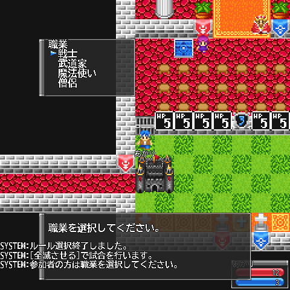

試合が始まると、見た目が職業ごとの戦場ゲーム用の姿（チームの色つき）に変わります。

### 行動順設定

チームの人の名前が並んだ一覧が出ます。名前を選ぶと **その人が1つ上に上がります**。
一番上の人から順に行動します。

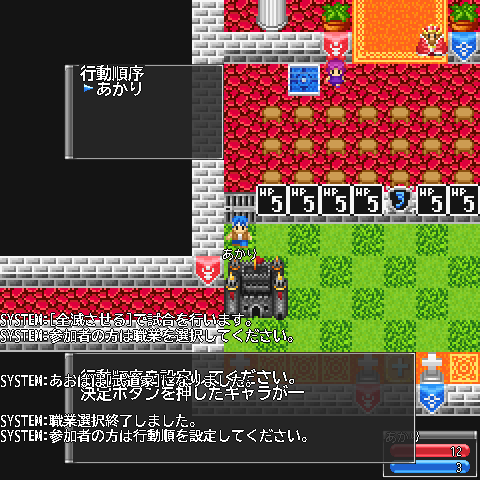

### 試合開始

「戦場ゲーム戦闘開始！」の笛で始まります。**先攻は赤・青のどちらかがランダム** で決まります。
フィールドの上には各チームの **残り HP の札**（名前の先頭、全角2文字ぶん）が並びます。真ん中の審判は、攻撃のたびに **振ったサイコロの目** を表示します。フィールドの下は、やられた人の待機場所と復活までのカウンターです。

---

## 自分の番でできること

自分の番になると音が鳴り、審判が「赤チーム[名前]の行動です。」と知らせます。コマンドを開くと4つ選べます。

| コマンド | 内容 |
| --- | --- |
| 移動 | ↑↓←→ から選んで **1マス** 動く。1ターンに **2歩まで**。番は続きます |
| 攻撃 | ↑↓←→ から方向を選び、**となりの敵** を攻撃。番は終わります |
| 魔法 | 魔法使い・僧侶だけ。番は終わります |
| 待機 | 番を終わります。**1歩も動かずに待機すると HP が1回復** |

| 行動選択 | 移動の方向 |
| --- | --- |
| 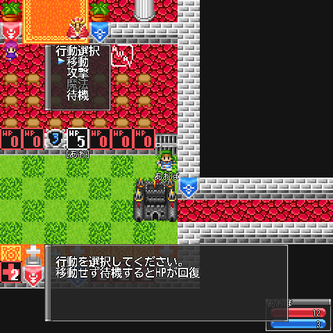 | 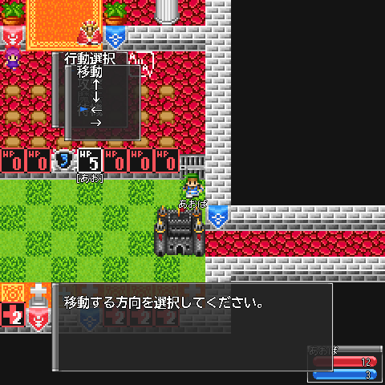 |

- 移動以外で番が終わります。つまり「1歩動いて攻撃」「2歩動いて待機」などの組み合わせになります。
- **2歩動いたあとは、攻撃と魔法は選べません**（待機だけ）。
- 攻撃した方向に誰もいない、味方だった、やられ中の人だった、というときは番は終わらず、選び直せます。
- 自分の番でないときは、勝手に歩くことはできません。
- 1歩ずつ「移動」→方向、を選び直して進みます（矢印キーで直接は歩けません）。

---

## サイコロのしくみ

攻撃・防御・魔法の結果は、すべて次の「サイコロ」で決まります（0〜4 の目、確率は 1/7 単位）。

| 目 | 0 | 1 | 2 | 3 | 4 |
| --- | --- | --- | --- | --- | --- |
| 確率 | 1/7 | 2/7 | 2/7 | 1/7 | 1/7 |
| 意味 | 失敗・ミス | 小 | 中 | 大 | 特別（職業ごとの技） |

---

## 攻撃と防御

攻撃すると、攻撃された人に **防御の選択** が出ます（コマンドを開くと選べます）。防御を選んだところで結果が決まります。

| 攻撃の方向を選ぶ | 防御を選ぶ（戦士） | 結果（通常防御で1ダメージ） |
| --- | --- | --- |
| 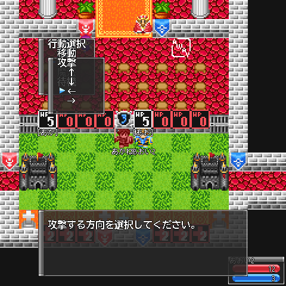 | 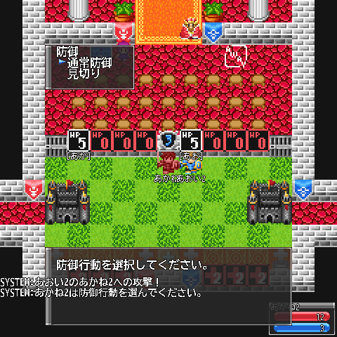 | 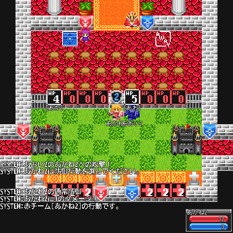 |

### 攻撃側

攻撃側がサイコロを振り、出た目がそのままダメージの元になります。

| 目 | 戦士 | 武道家 | 魔法使い・僧侶 |
| --- | --- | --- | --- |
| 0 | ミス | ミス | ミス |
| 1〜3 | 目の数 | 目の数 | 目の数 |
| 4 | **全力攻撃**（4） | **回し蹴り**（下を参照） | ミス |

- **回し蹴り（武道家）**: 自分のまわり1マス（ななめも含む8マス）にいる **敵全員に 2 ダメージ**。相手が選んだ防御は関係ありません。

### 防御側

職業によって選べる防御がちがいます。

| 職業 | 選べる防御 |
| --- | --- |
| 戦士 | 通常防御 / 見切り |
| 武道家 | 通常防御 / 受け身 / カウンター |
| 魔法使い | 通常防御 |
| 僧侶 | 通常防御 |

| 防御 | 効果 |
| --- | --- |
| 通常防御 | ダメージが **1 減る**（確実） |
| 見切り | 防御側もサイコロ。**4 ならダメージ0**。**1〜3 なら反撃**して攻撃した人にその目のダメージ（ただし自分も満額受ける）。0 なら何も起きず満額 |
| 受け身 | 防御側もサイコロ。**1〜3 ならその分ダメージが減る**。0・4 なら満額 |
| カウンター | 防御側もサイコロ。**2〜3** なら、その分ダメージを減らして、攻撃した人にその目のダメージ。**4** なら、自分は満額受けるが、攻撃した人にも同じダメージ。0〜1 か、攻撃側と同じ目のときは何も起きず満額 |

ダメージが 0 以下になると「〜の攻撃は効かなかった」になります。

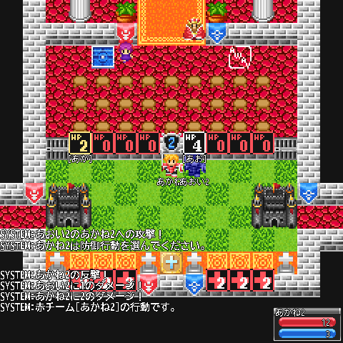

上は、戦士の「見切り」で反撃が出たところです。攻撃した側に1、見切った側にも2のダメージが入っています。

### 例

- 戦士が 2 を出して、相手が通常防御 → 1 ダメージ
- 戦士が全力攻撃（4）、相手の武道家が受け身で 3 → 1 ダメージ
- 武道家が 3 を出して、相手の武道家がカウンターで 2 → 相手に 1、攻撃した人に 2

---

## 魔法

### 魔法使い：炎

- **ちょうど2マス先**（たて＋よこの歩数がぴったり2）の敵だけに撃てます。となりや3マス以上先には撃てません。
- サイコロで **0 は失敗**、1〜3 はその目、4 は 3 のダメージ（最大3）。**防御はできません**。
- **相手も魔法使いだと「跳ね返し」** の判定があります（4 の目で撃ったときは判定なし）。
  - 相手がサイコロで1〜3を出し、こちらより大きい → 差の分だけ **撃った人がダメージ**
  - 同じ目 → 相殺されて何も起きない
  - それ以外 → 普通に当たる

### 僧侶：回復

- **2マス以内**（自分も含む）の味方を回復します。HP が満タンの人には効果がありません。
- サイコロで **0 は失敗**、1〜3 はその分回復、**4 なら完全回復**。

### 僧侶：蘇生

- やられている味方を1人選んで復活させます（距離は関係なし）。
- 成功するのは **サイコロが 0 か 4 のとき**（2/7）。1〜3 は失敗です。
- 復活すると開始位置に戻り、**HP 3** から再開します。

---

## やられたとき・復活

- HP が 5 減るとやられて、フィールドの外の待機場所に移されます。やられ中の人は攻撃や炎の対象になりません。
- **城へ到達ルール** では、やられ中も自分の番が来るたびにカウンターが進み、**3回目で自動復活**（開始位置・HP 3）。復活した番はそのまま次の人に回ります。
- **全滅させるルール** では自動復活はありません。僧侶の蘇生だけが頼りです。
- チーム全員がやられた時点で「試合終了！」、相手チームの勝ちです。
- 反撃やカウンターでも、攻撃した側がやられることがあります（試しに遊んだ試合では、見切りの反撃3ダメージで攻撃側が倒れて決着しました）。

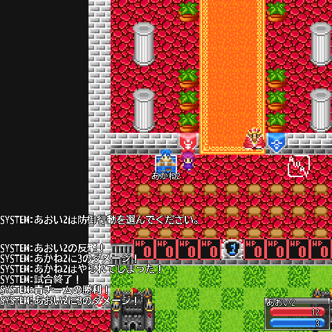

---

## 城へ到達

- 赤チームはフィールドの左（西）、青チームは右（東）から始まります。**相手の開始位置のあたりが相手の城** です。
- 城は 2×2 マスの範囲です。城のマスに入って **「待機」を選んだときに** 到達になり、その場で勝ちが決まります（移動しただけでは到達になりません）。

---

## 試合が途中で終わるとき

- 参加者が抜けたりログアウトしたりして、**片方のチームが0人** になるか、**全体で1人以下** になると試合は終わります。
- 試合が終わると、参加者は全員受付の場所に戻り、見た目も元に戻ります。

---

## おまけ：設定とコードのメモ（運営・開発者向け）

- 戦場ゲームの設定は `Release/SBODATA/SboDataSubGameInfo.dat` にあり、今は **マップ71「戦場ゲーム場」・4人戦** の1つだけです。
  - 受付 (22,14)、審判 (25,18)、フィールド (20,19)〜(30,22)
  - 開始位置: 赤 x=20 / 青 x=30（y=19 から下に1人ずつ）、城: 赤 (20,20) / 青 (29,20) から 2×2
  - HP 表示: 赤 x=21〜 / 青 x=26〜（y=18）、復活カウンター: 赤 x=21〜 / 青 x=27〜（y=24）
- 処理の本体はサーバーの `SboSvr/src/Proc/SubGame/ProcSubGameWAR.cpp`、コマンドの受け取りは `SboSvr/src/SboSvrRecvCmd.cpp` の `RecvDataProcSubGameWAR_*`、画面とキー操作はクライアントの `SboCli/src/SboCliKeyProc.cpp` / `SboCliDrawWindow.cpp` の `SUBWAR_*` です。
- コードを読んで気づいた、直すかもしれない点:
  - 参加チケットを使うときの「満員」チェックが効いていません（設定値 0/1 と人数 3/4 を比べている）。チーム選択の時点で1チーム4人までは止まります。
  - 3人戦の設定だと、城の範囲を決める変数が初期化されずに使われます（今のデータは4人戦なので影響なし）。
  - 魔法使いの防御メニューに「跳ね返し」用の画面がありますが、使われていません（跳ね返しは自動で判定されます）。
