# 爆弾ゲーム

フィールドに **爆弾を置いて、爆風で相手を吹き飛ばす** アクション系のミニゲームです。
レンガの壁を壊すとアイテムが出てきて、置ける爆弾の数や火力がどんどん増えていきます。

> このページは、ソースコードからルールを読み取り、ローカルのサーバーで3人のキャラクターを動かして実際に遊んで確かめたものです。
> スクリーンショットはそのときのものです（数字はコードどおり）。

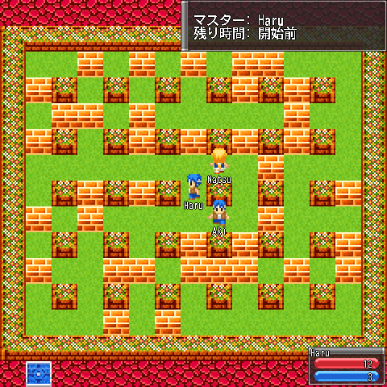

---

## ざっくり言うと

- **爆弾ゲーム場** で、配布係から **「爆弾ゲーム参加チケット」** をもらいます。
- **青い床** の上でチケットを使うと参加。**最初に参加した人がゲームマスター** になります。
- マスターが **S キー**（スマホは **「調べる」ボタン**）で設定メニューを開き、「試合開始」を選ぶとスタート。
- 試合中は **Z キー**（スマホは **「キャンセル」ボタン**）で足元に爆弾を置きます。約3秒で十字に爆発。
- 爆風に当たると **失格** で、受付（青い床）に戻されます。
- **制限時間がくるか、マスターが「試合中止」を選ぶと試合終了**。勝ち負けの判定はないので、最後まで残った人が勝ち、のように遊びます。

---

## 行き方

1. 始まりの町の **右上（北東）のほう** にある入口から **「多目的遊戯場 ※工事中」** に入ります。
2. 十字の部屋のまんなかに出ます。**左の階段** が爆弾ゲーム場です。
   （右の階段は戦場ゲーム場、上の階段は雪合戦場、まんなかは始まりの町へ戻る階段です）

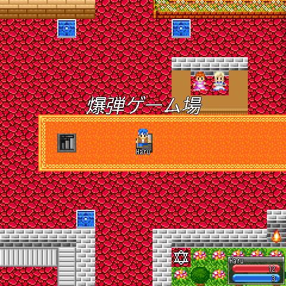

爆弾ゲーム場の中にも階段があり、**「巨大爆弾ゲーム場」**（左の階段）と **「爆弾ゲーム公式競技場」**（右の階段）にもつながっています。

---

## チケットをもらう

入ってすぐ上のカウンターに、**説明係**（左）と **配布係**（右）がいます。カウンター越しに話しかけられます（X でコマンド →「話す」）。

説明係は遊び方を教えてくれます。

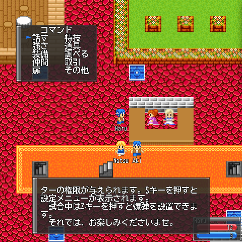

> 最初に参加したプレイヤーにはゲームマスターの権限が与えられます。Sキーを押すと設定メニューが表示されます。
> 試合中はZキーを押すと爆弾を設置できます。

配布係に話しかけると **「爆弾ゲーム参加チケット」** がもらえます（いまは「お試し期間」で無料、何度でももらえます）。

| 配布係に話しかける | 道具にチケットが入る |
| --- | --- |
| 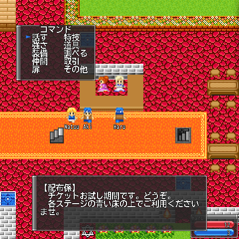 | 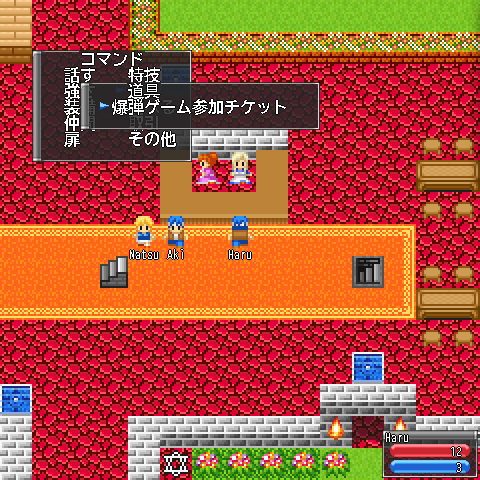 |

- チケットは **使うとなくなります**。試合ごとに1枚ずつもらってください。
- ほかに **「爆弾フリーパス」**（使ってもなくならない参加券）というアイテムもデータにはありますが、配っている人はいません。

---

## 参加する

### 1. 青い床の上に立つ

爆弾ゲーム場には、試合用のコート（ステージ）がいくつもあり、それぞれの入口に **青い床（受付）** があります。
たとえば配布係のカウンターのすぐ上、緑のコートの入口にある青い床がそうです。

### 2. チケットを使う

X でコマンド →「道具」→「爆弾ゲーム参加チケット」→「使う」。

- 青い床以外で使うと「ここは受け付け場所ではないようです。」と出ます。
- 使うとコートの中のスタート地点に移動します。

### 3. コートの中で待つ

右上に **マスターの名前** と **残り時間** が出ます。試合が始まるまでは「開始前」です。

| 青い床に立つ | チケットを使う | コートに入った（右上にマスターと残り時間） |
| --- | --- | --- |
| 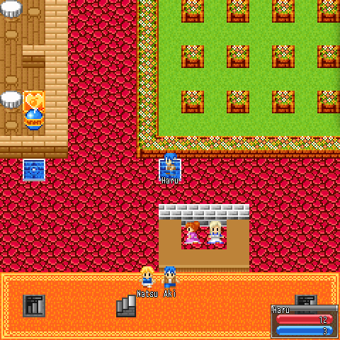 | 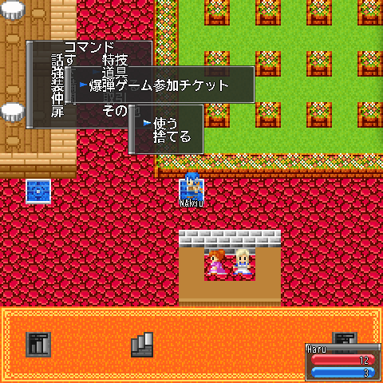 | 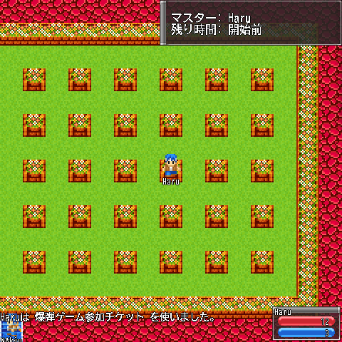 |

- **その試合の最初の参加者がゲームマスター** です。2人目からは普通の参加者になります。
- 試合開始前は、レンガの壁があってもすり抜けて歩けます（ぶつかるのは試合中だけ）。

---

## マスターの設定メニュー

マスターは試合が始まる前に **S キー**（スマホは **「調べる」ボタン**）で設定メニューを開けます。
↑↓ で選んで X で値を切り替えます。Z で閉じます。

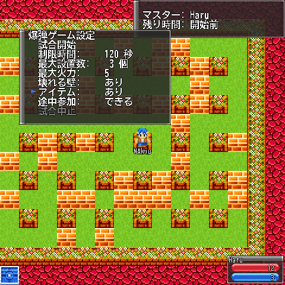

| 項目 | 切り替え（X を押すごと） | はじめの値 | 内容 |
| --- | --- | --- | --- |
| 試合開始 | ― | ― | 設定を送って試合を始めます |
| 制限時間 | 30秒ずつ増えて 240秒 の次は **無制限**、その次は 30秒 | 60秒 | 0 になると試合終了 |
| 最大設置数 | 1 → 2 → … → 5 → 1 | 1個 | 1人が同時に置ける爆弾の数の上限 |
| 最大火力 | 3 → 4 → … → 10 → **ランダム** → 3 | 3 | 爆風の長さの上限。ランダムは爆弾ごとに 1〜10 |
| 壊れる壁 | あり / なし | なし | 「あり」にした瞬間にコートにレンガの壁がばらまかれます |
| アイテム | あり / なし | なし | 壁を壊したときにアイテムが出るか |
| 途中参加 | できる / できない | できる | 試合中にチケットを使って入れるか |
| 試合中止 | ― | ― | 試合中だけ選べます（下を参照） |

- **アイテムなし** のときは、全員が最初から「最大設置数」「最大火力」の値で戦います。
- **アイテムあり** のときは、全員 **爆弾1個・火力3** から始まり、アイテムで「最大」まで増やしていきます。
- 壊れる壁は、コートの歩ける場所の **約3割** にランダムに置かれます。参加者の立っている場所に置かれることもあります。
- 設定は「試合開始」を選んだときにまとめて送られます（「壊れる壁」だけは切り替えた瞬間に反映）。

---

## 試合の流れ

### 試合開始

マスターが「試合開始」を選ぶと、参加者全員に「爆弾ゲーム試合開始！」と笛の音。残り時間が減りはじめます。

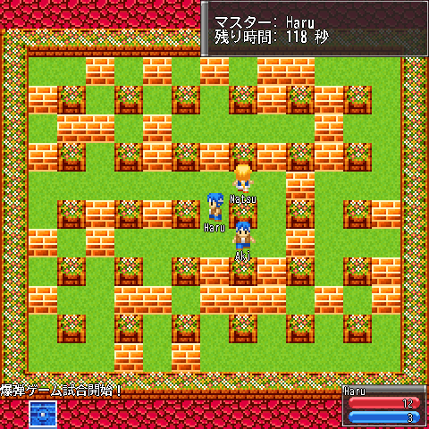

### 爆弾を置く

**Z キー**（スマホは **「キャンセル」ボタン**）で、自分の足元に爆弾を置きます。

- 同時に置ける数には上限があります（はじめは1個）。爆発し終わるとまた置けます。
- 爆弾は置いてから **約3秒** で爆発し、爆風は **約0.8秒** 残ります。
- 爆弾は通り抜けられません（「爆弾すり抜け」を取っていれば別）。
- 試合中は X キーでコマンドを開けません（リモコンを持っているときは爆発ボタンになります）。

### 爆風

爆風は **上下左右に十字** にのびます。とどく長さは **火力 − 1 マス**（火力3なら2マス先まで）です。

| 置いて離れる | 十字に爆発 |
| --- | --- |
| 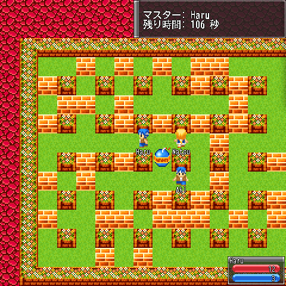 | 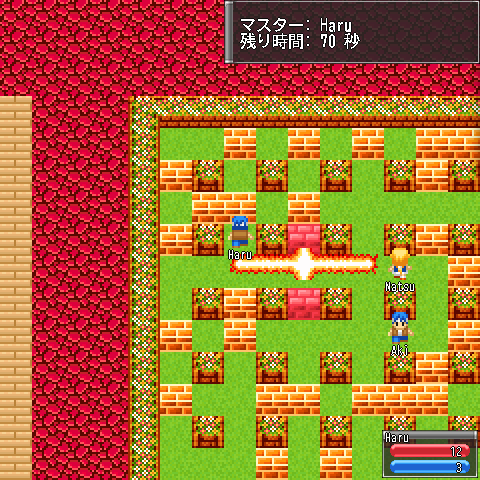 |

- 動かない柱（コートに等間隔で立っている植木の柱）で止まります。
- **レンガの壁に当たると、その壁を壊して止まります**（その先にはとどきません）。
- 爆風が別の爆弾に当たると、その爆弾もすぐ爆発します（**誘爆**）。
- 床に落ちているアイテムに当たると、アイテムは消えます。

### アイテム

壊れたレンガは少しして消え、**35% の確率でアイテム** が出ます。上を歩くと拾えます。

| レンガのあとにアイテム | 拾うと「個数UP」 |
| --- | --- |
| 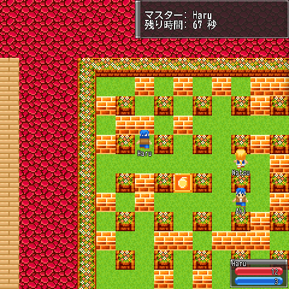 | 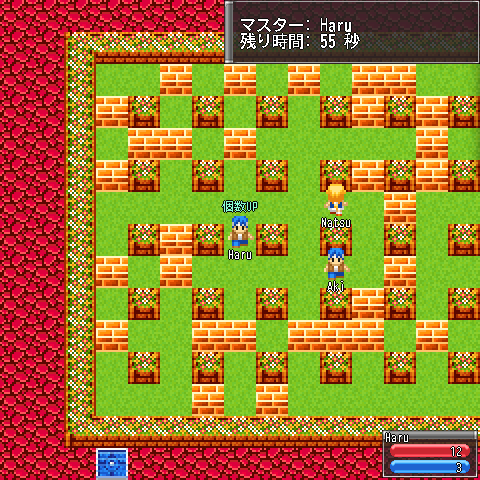 |

| アイテム | 効果 | 出やすさ（アイテムが出たとき） |
| --- | --- | --- |
| 個数UP | 置ける爆弾が1個増える（最大設置数まで） | 約45% |
| 火力UP | 火力が1上がる（最大火力まで） | 約40% |
| リモコン | 自分の爆弾が勝手に爆発しなくなり、**X キーで全部まとめて爆発** させられる | 約3% |
| 壁すり抜け | レンガの壁を通り抜けられる | 約3% |
| 爆弾すり抜け | 爆弾を通り抜けられる | 約3% |
| 即爆発 | **コートにあるすべての爆弾**（ほかの人のも）がその場で爆発 | 約3% |
| パワーダウン | 爆弾1個・火力3に戻り、リモコンなどの効果も消える（ハズレ） | 約3% |

- 効果は、その試合の間だけです。

### 爆風に当たったら

爆風に当たると **失格** です。受付の青い床に戻されて、その試合にはもう戻れません（途中参加できる設定なら、もう一度チケットを使えば入れます）。

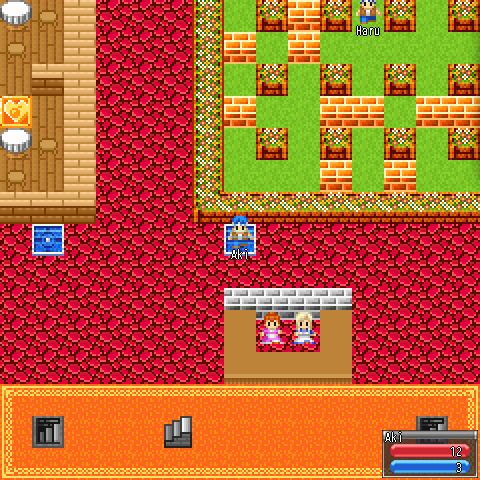

- **マスターが当たったとき** も受付に戻されますが、マスターの権限は残ります。このとき S キーで設定メニューを開くと **「試合中止」** が選べるようになっています。

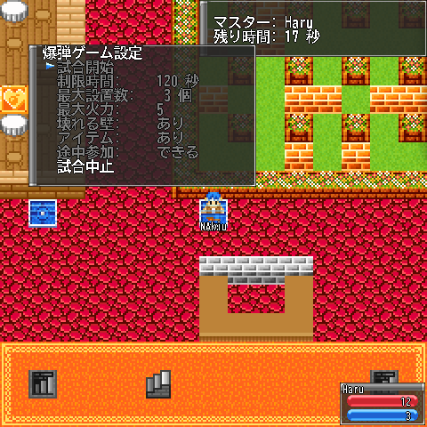

### 試合終了

次のどちらかで試合が終わります。

- **残り時間が 0 になる**
- **マスターが「試合中止」を選ぶ**（マスターが失格になったあとに選べます）

試合が終わると、コートに残っていた人は受付に戻り、レンガやアイテムは消えて、設定もはじめの値に戻ります。
マスターもいなくなるので、**次に最初にチケットを使った人が次のマスター** です。

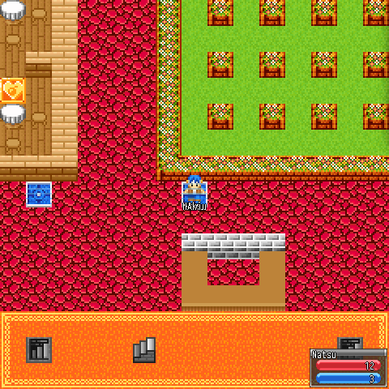

- 勝ち負けの判定や賞品はありません。「最後まで残った人の勝ち」などのルールはみんなで決めて遊んでください。
  （データには「爆弾王の証」「爆弾ゲーム大会優勝」の記念品があり、昔の大会の賞品だったようです）

---

## そのほかの決まり

- **参加していない人がコートに入ろうとすると、受付に戻されます**（管理者は入れます）。
- 参加者がコートの外で Z キーを押すと「爆弾ゲーム参加解除しました。」と出て、参加をやめられます。**マスターがこれをすると試合ごと終わります**。
- 「無制限」にした試合は、時間では終わりません。**マスターが爆風に当たるまで「試合中止」を選べない** ので、マスターも積極的に戦いましょう。

---

## 操作のまとめ

| やりたいこと | PC | スマホ（仮想パッド） |
| --- | --- | --- |
| 話す・チケットを使う | X（コマンド） | 決定ボタン |
| 設定メニューを開く（マスター・試合前） | **S** | **「調べる」ボタン** |
| 設定を切り替える / 閉じる | X / Z | 決定 / キャンセル |
| 爆弾を置く（試合中） | **Z** | **キャンセルボタン** |
| リモコンで爆発（リモコンを持っているとき） | X | 決定ボタン |

試合に参加している間は、S キーは「調べる」ではなく設定メニュー用になります（マスター以外は何も起きません）。

---

## おまけ：設定とコードのメモ（運営・開発者向け）

- コートの設定は `Release/SBODATA/SboDataSubGameInfo.dat` にあり、爆弾ゲームは **11面** あります（受付の青い床の座標）。
  - マップ41「爆弾ゲーム場」: (34,18)・(28,18)・(40,27)・(29,28)・(51,15)・(56,39)
  - マップ72「巨大爆弾ゲーム場」: (20,36)・(20,56)・(8,54)
  - マップ84「爆弾ゲーム公式競技場」: (4,11)・(22,8)
- 配布係は、爆弾ゲーム場 (36,21)・巨大爆弾ゲーム場 (24,41)・(25,52)・公式競技場 (4,8) にいます（セリフの `@400015` でアイテム16番＝チケットを渡す）。
- 処理の本体は、サーバーの `SboSvr/src/SboSvrSubGameProc.cpp`（時間・試合終了・壁）、`SboSvr/src/SboSvrRecvCmd.cpp` の `RecvDataProcSubGameBOMB_*`（設置・設定・開始・アイテム・リモコン）、`SboSvr/src/CharProc/CharProcBOMB.cpp`（爆発と当たり判定）、`CharProcBOMBBLOCK.cpp`（壁とアイテムの出現）、参加は `SboSvr/src/SboSvrItemProc.cpp` の `ItemUse_SUBGAME_BOMB` です。クライアントは `SboCli/src/SboCliKeyProc.cpp`（S/Z/X キー）と `SboCliDrawWindow.cpp` の `SUBGAME_BOMB*`。
- 遊んでみて・コードを読んで気づいた、直すかもしれない点:
  - **試合のあと、カウンターの説明係・配布係が見えなくなり「その方向には誰もいません。」になることがあります**（爆弾を置いた人の画面で起きました。一度階段で出入りすると戻ります）。
  - アイテム「耐火」（爆風に当たらない）の処理はありますが、出現の抽選で「耐火」のつもりの枠が「個数UP」になっていて、出てきません。
